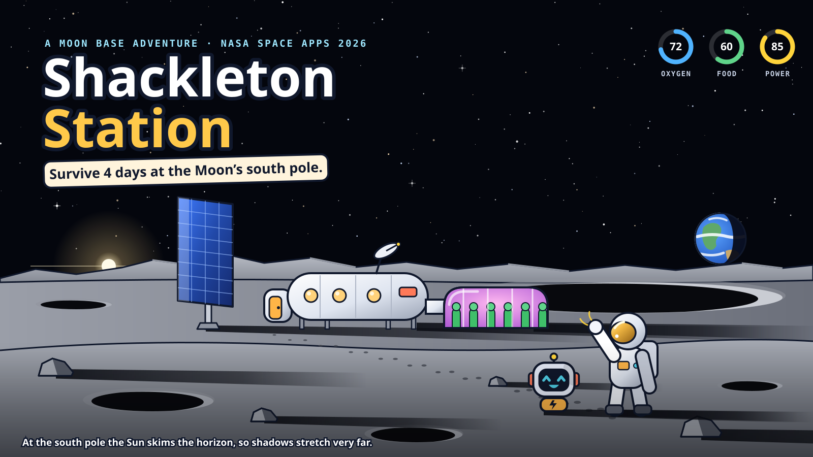
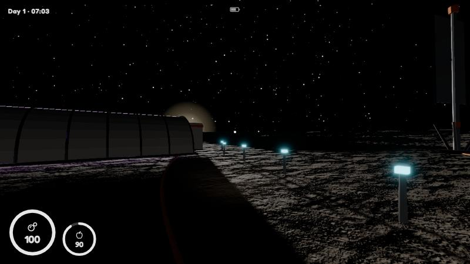
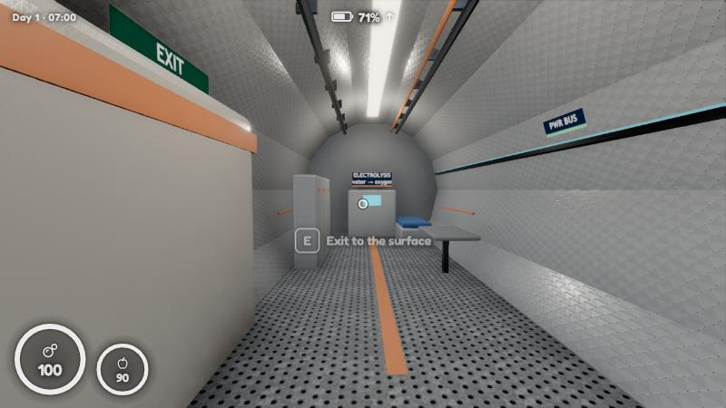
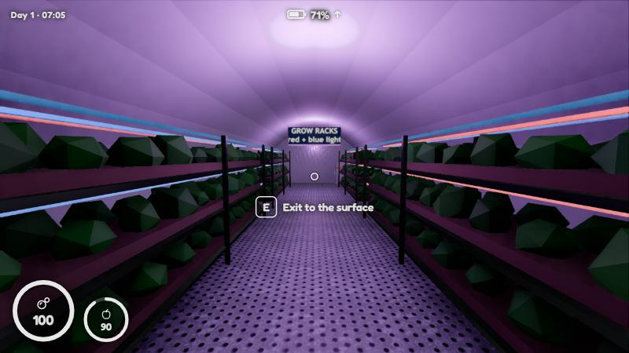

<p align="center">
  
</p>

<h1 align="center">Shackleton Station</h1>

<p align="center">
  A 3D survival game for kids aged 7 to 12, set at a small base on the Moon's south pole.<br>
  Built for the <b>NASA Space Apps Challenge 2026</b>. Runs in the browser, with no download and no account.
</p>

<p align="center">
  <a href="#overview">Overview</a> ·
  <a href="#how-it-answers-the-challenge">The challenge</a> ·
  <a href="#screenshots">Screenshots</a> ·
  <a href="#real-nasa-data">NASA data</a> ·
  <a href="#run-it">Run it</a> ·
  <a href="#controls">Controls</a>
</p>

## Overview

We built Shackleton Station, a 3D survival game for kids aged 7 to 12 that runs in a web
browser with no download or account. The player is an astronaut at a small base on the rim of
Shackleton Crater, at the Moon's south pole, and must survive four work shifts. Oxygen, food
and power keep running down, and every fix has a cost: grow lights make food but drain the
battery, and water in the shelter walls blocks radiation but can't become oxygen. Mini-games
teach the science behind each system, like splitting water into hydrogen and oxygen or patching
a leak after a micrometeoroid hit.

The challenge asked for real engineering trade-offs built on real NASA data. The terrain comes
from LRO laser altimeter maps, particle storms replay NASA DONKI records, and drain rates use
NASA's life-support baseline values. The in-game Databank credits a source for every fact.

Artemis is sending astronauts to this region. Kids who play learn why a base there is hard to
keep alive by making the kinds of choices those crews will face.

## How it answers the challenge

The brief asked for five trade-offs kids should feel for themselves. Each one is a system in
the game, and none of them has a free option.

| Trade-off in the brief | What the player does in the game | What it costs |
|---|---|---|
| Life support | Makes oxygen at the Electrolysis unit by splitting water (three mini-games). | Water and battery power. Every airlock trip also loses 1 % of the air. |
| Radiation shielding | Runs to the storm shelter when a real solar particle storm arrives, and can fill the shelter walls with water. | Water in the walls blocks more radiation but can no longer be split into oxygen. |
| Power | Watches one shared battery fed by a vertical solar array, and repairs the array after a micrometeoroid hit (Solar Fix). | Every machine and the grow lights draw from it. A blackout stops the machines. |
| Food production | Grows potatoes, lettuce and radishes under grow lights. Potatoes fill you up but take two nights; greens are quick but mostly water. | Grow lights use power. Food is not refilled overnight. |
| Communication delay | Orders supplies from Earth at the supply terminal. | Each order waits for the real 1.28 s light delay and must fit a 60 kg lander. |

Two more rules run through the whole game. We speed up time but never change cause and
effect, and when a number is sped up the game says so ("In real life a potato takes about
3 months"). Failure is gentle: when a gauge hits zero the astronaut wakes up back in the
habitat and loses time, with no death screen.

## Screenshots

| Outside on the crater rim | Habitat work bay | Greenhouse |
|---|---|---|
|  |  |  |

## What is in the game

- **The mission.** Survive 4 days. Each day is a 6-minute shift (07:00 to 19:00). Make it to
  19:00 and the next morning oxygen, power and water are topped up, but your food isn't. Crops
  keep growing overnight.
- **Training Day.** Day 1 is a guided tour with Volt, a helper robot with a voice. He walks you
  to each machine and explains what it does, with the base clock slowed down.
- **The base** sits on the real Shackleton Crater rim: a habitat (sleeping nook with a storm
  shelter, lounge and galley, work bay), a greenhouse, a vertical solar array, a cold-trap
  crater for ice, a telescope and a cargo pad.
- **The sky** is black with 1,640 real stars, a low Sun circling the horizon and Earth near it.
  Live sky mode shows where the Sun, Earth and stars really are over the south pole right now.
- **Gauges.** Oxygen (blue ring) is one shared supply for the habitat, greenhouse and suit.
  Food is the green ring and base power is the battery at the top. A dose ring appears during
  particle storms.
- **Mini-games**, each a short lesson that teaches the real science while you refill:
  - Electrolysis: Molecule Zapper, Bubble Detective, Atom Match
  - Solar Fix: Cell Swap, Hot Spot Hunt, Wire Fix
  - Leak Fix: Leak Hunt, Hatch Hunt, Patch It
  - Ice Drill and Ice Oven, Water Walls, Telescope Star Hunt
- **Events.** Particle storms come from real NASA data: a *Stormy Sun* replay of May 2024 or
  *Live* data. A random micrometeoroid hit either cracks the solar array (less power) or punches
  a tiny hole in the habitat (oxygen drains about 2.2 times faster until you patch it), never
  both at once.
- **Airlock.** The airlock cycles from the inside, with a pressure gauge and air sounds, and a
  helmet visor goes on before you step outside.

## Real NASA data

The game uses real data and credits it on screen. Archived data is labeled "Replay of real
data from (date)", and only data fetched right now is labeled "Live".

| Data | Source | Used for |
|---|---|---|
| Life Support Baseline Values and Assumptions Document (BVAD), 2022 | [NASA NTRS](https://ntrs.nasa.gov/citations/20210024855) | Oxygen, food and water drain rates, including the faster rate on a spacewalk |
| Space weather: flares and solar energetic particle events | [NASA DONKI](https://ccmc.gsfc.nasa.gov/donki/) | Particle storms (May 2024 replay, or Live) |
| Radiation dose: LRO CRaTER and ISS Timepix | [NASA RadLab](https://visualization.osdr.nasa.gov/radlab/gui/overview/) | Storm strength and how doses compare |
| South pole elevation: LRO LOLA (LDEM_875S_5M, LDEM_80S_80M) | [PDS Geosciences Node](https://pds-geosciences.wustl.edu/missions/lro/lola.htm) | The terrain around Shackleton Crater and the real horizon |
| Yale Bright Star Catalog | [NASA HEASARC](https://heasarc.gsfc.nasa.gov/W3Browse/star-catalog/bsc5p.html) | The 1,640 stars in the sky |
| Moon orientation (IAU, JPL NAIF), checked against JPL Horizons | [JPL Horizons](https://ssd.jpl.nasa.gov/horizons/) | Live sky positions of the Sun and Earth |
| LCROSS and LRO Diviner results | NASA | How much ice the cold traps hold |

Every fact and number in the game, with its source, is listed in
[`docs/SCIENCE.md`](docs/SCIENCE.md). Numbers we picked for game balance are marked as such in
[`src/config/gameplay.js`](src/config/gameplay.js).

## Run it

You need [Node.js](https://nodejs.org/) 20.19 or newer (or 22.12+).

```bash
npm install
npm run dev      # http://localhost:5173
```

Other commands:

```bash
npm test         # pure-logic unit tests (189)
npm run balance  # bots play a lunar day on the real rules (balance check)
npm run build    # production build in dist/ (base path /Shackleton-Station/)
```

If `npm install` cannot reach registry.npmjs.org on your network, add
`--registry=https://registry.yarnpkg.com` (official npm mirror).

## Controls

| Key | Action |
|---|---|
| Mouse | Look (click to lock the mouse; if the browser refuses, drag to look) |
| W A S D / arrows | Walk |
| Shift | Hop faster |
| Space | Jump (Moon gravity is 1/6 of Earth's) |
| E | Use, open doors, start a mini-game, or talk to Volt (look at him) |
| F | Eat (fresh greens first, then potatoes) |
| Tab | PDA: detailed stats, Databank (science and NASA sources), Star Album, log |
| Enter | Next step in Volt's Training Day |
| Esc | Pause (time notes, credits, graphics, sound, Volt settings), or leave a mini-game |

Mini-games show their own controls, for example click or Space to zap, or S for the Ice Drill
scanner.

## Built with

- [Vite](https://vitejs.dev/) and [three.js](https://threejs.org/), in plain JavaScript (ES modules)
- pmndrs `postprocessing` and `n8ao` for ambient occlusion, bloom and tone mapping (High quality only)
- HTML and CSS for the HUD, menus and every mini-game
- `mespeak` (eSpeak) in a Web Worker for Volt's voice
- Node's built-in test runner for 189 unit tests on the game logic

The game logic in `src/systems/` has no three.js imports, so it can be tested and tuned on its
own. A balance simulator (`npm run balance`) has bots play the real rules to check that the
mission is hard but possible.

## Known limitations

- The *Calm Sun (Dec 2019)* data file is missing, so choosing Calm currently plays the Stormy
  May 2024 replay. Running `scripts/fetch-space-weather.mjs` with a NASA API key fixes it.
- Keyboard and mouse only for now; touch controls are planned.
- Still to come: moonquakes, dust on the panels, a comms dish lesson, scheduled supply landers
  and Mission Control tasks. The full list is in [`docs/GAME_DESIGN.md`](docs/GAME_DESIGN.md).

## For developers

### Updating real data

```bash
NASA_API_KEY=your_key node scripts/fetch-space-weather.mjs   # public/data/space-weather-*.json
node scripts/fetch-stars.mjs                                 # public/data/stars-bsc.json
node scripts/fetch-lola.mjs                                  # src/data/lolaTerrain.js
```

Get a free key at https://api.nasa.gov (the shared `DEMO_KEY` is rate-limited). For Live mode
in the browser, put `VITE_NASA_API_KEY=your_key` in `.env`, which is never committed.

### Performance check

Add `?fps` to the URL (for example `http://localhost:5173/?fps`) to show fps, frame time and
draw calls. Graphics Low/High is in the start and pause menus. On High, ambient occlusion turns
itself off if frames get slow. See [`docs/PERFORMANCE.md`](docs/PERFORMANCE.md).

### Deploying

The GitHub Pages workflow (`.github/workflows/deploy.yml`) is manual only, so pushing does not
deploy. To publish: *Actions → Deploy to GitHub Pages → Run workflow* (and set
*Settings → Pages → Source: GitHub Actions* once).

### Where things live

| Path | What it holds |
|---|---|
| `src/config/gameplay.js` | Every rate and cost, each sourced or marked GAME BALANCE |
| `src/systems/` | Pure, unit-tested logic: gauges, days, electrolysis, radiation, space weather, ice mining, airlock, Volt's brain, navigation, live sky, balance bots |
| `src/world/` | Terrain, sky, lighting, buildings, Volt, guide trail |
| `src/instances/` | The 2D lessons and mini-games |
| `src/farming/`, `src/supply/`, `src/training/` | Farming, supplies, Training Day |
| `src/ui/` | HUD, PDA, menus, Volt's speech bubble and voice, visor, sounds |
| `docs/SCIENCE.md` | Every fact and number with its source |
| `docs/GAME_DESIGN.md` | The game design |
| `docs/HANDOFF.md` | Start here if you are continuing the project |
| `CLAUDE.md` | Project rules, current state and known issues |
| `CHANGELOG.md` | Every version |

## Credits

Textures and music are CC0 (public domain): textures from ambientCG and Poly Haven, and the
music tracks "Outer Space Loop" by wipics and "Blue Moon Beach" by Tsorthan Grove, both from
OpenGameArt. Fonts are Fredoka and Nunito (SIL Open Font License). Volt's voice uses meSpeak
and eSpeak (GPL-3.0). All sound effects are generated in the browser. The full list is in
[`public/CREDITS.md`](public/CREDITS.md).
